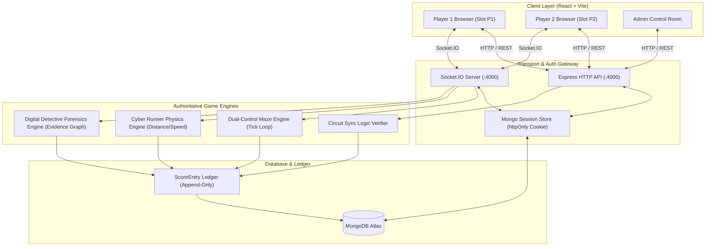

# 🎮 CypherClash — Game Integrations & Multiplayer Platform

> **Branch:** `integrate-my-games`  
> **Tournament Engine:** OsCode CypherClash Cybersecurity Tournament Platform  
> **Architecture:** Node.js / Express · Socket.IO · MongoDB Atlas · React 18 · Vite · Three.js

---

## 📌 Overview

This branch (`integrate-my-games`) brings together the full suite of cooperative multiplayer cybersecurity tournament games into the centralized **CypherClash** platform. Standalone mini-games and forensics modules have been unified into a single full-stack architecture featuring real-time Socket.IO synchronization, shared team sessions with concurrent multi-device support, authoritative backend simulation loops, and an append-only scoring ledger.



---

## 🚀 Key Integrations Completed

| Round | Game / Module | Mode | Key Innovation / Mechanics | Status |
|:---:|---|---|---|:---:|
| **R1** | **Dual-Control Maze** | 2-Player Co-op Real-time | Split-axis directional steering (`P1`: Y-axis, `P2`: X-axis) with authoritative collision engine | ✅ Fully Integrated |
| **R1** | **Cyber Runner** | 2-Player Reflex Real-time | Split-skill endless sprint (`P1`: Jump/Slide acrobatics, `P2`: Lane-switching) | ✅ Fully Integrated |
| **R1** | **Circuit Sync** | Logic Co-op | Boolean logic gate repair with server-side deterministic replay | ✅ Fully Integrated |
| **R3** | **Digital Detective** | Asymmetric Forensics | Specialized roles (`P1`: Comms/OSINT, `P2`: SIEM/SOC) with shared evidence correlation board | ✅ Fully Integrated |
| **Core** | **Socket.IO Hub** | Networking | Unified HTTP + Socket.IO server with session-aware room dispatching and multi-transport support | ✅ Fully Integrated |
| **Core** | **Player Slot System** | Identity & Sessions | `POST /api/team/slot` for live `P1`/`P2` allocation across multiple team devices | ✅ Fully Integrated |

---

## 🕹️ Deep Dive: Integrated Games

### 1. Dual-Control Maze (Round 1 Co-op Mini-Game)
* **Frontend Route:** `/dashboard/maze`
* **Source Files:**
  * Client: [`src/games/maze/MazeApp.jsx`](file:///c:/Users/hp/OneDrive/Documents/Desktop/CypherClashFinal/CypherClash-2/src/games/maze/MazeApp.jsx), [`src/games/maze/components/MazeCanvas.jsx`](file:///c:/Users/hp/OneDrive/Documents/Desktop/CypherClashFinal/CypherClash-2/src/games/maze/components/MazeCanvas.jsx)
  * Server Engine: [`server/src/games/maze_engine/gameEngine.js`](file:///c:/Users/hp/OneDrive/Documents/Desktop/CypherClashFinal/CypherClash-2/server/src/games/maze_engine/gameEngine.js)
  * Socket Handler: [`server/src/games/mazeSocket.js`](file:///c:/Users/hp/OneDrive/Documents/Desktop/CypherClashFinal/CypherClash-2/server/src/games/mazeSocket.js)

#### Gameplay Mechanics & Split Controls
To escape the cyber grid, players must coordinate their movements in perfect synchrony:
* **Player 1 (Vertical Operator):** Steers exclusively on the vertical axis (`W` / `ArrowUp` for Up, `S` / `ArrowDown` for Down).
* **Player 2 (Horizontal Operator):** Steers exclusively on the horizontal axis (`A` / `ArrowLeft` for Left, `D` / `ArrowRight` for Right).

#### Engine Features
* **Authoritative Tick Loop:** Runs at 30-60 Hz on Node.js; moves the cyber avatar based on valid inputs received from both slots.
* **Environmental Hazards & Pickups:** Interactive barriers, moving traps, speed boost nodes, data shards, and exit portals.
* **Real-time Canvas Rendering:** Custom Canvas/Three.js visual pipeline with dynamic trail rendering, obstacle glows, and collision sparks.
* **Solo Dev Simulation:** Built-in simulation toggle (`simulatePartnerConnect`) enables solo testing of two-player coordination.

#### Socket Protocol
* `maze:join_room` — Joins team-scoped session room (`teamId`, `sessionId`, `playerId`).
* `maze:player_input` — Transmits axis motion vector (`axis: 'x' | 'y'`, `dir: -1 | 1`).
* `maze:game_tick` — Broadcasts world state (coordinates, active items, timer, score).
* `maze:game_over` — Broadcasts victory/loss with granular score breakdown.

---

### 2. Cyber Runner (Round 1 Reflex Mini-Game)
* **Frontend Route:** `/dashboard/runner`
* **Source Files:**
  * Client: [`src/games/runner/RunnerApp.jsx`](file:///c:/Users/hp/OneDrive/Documents/Desktop/CypherClashFinal/CypherClash-2/src/games/runner/RunnerApp.jsx), [`src/games/runner/components/RunnerCanvas.jsx`](file:///c:/Users/hp/OneDrive/Documents/Desktop/CypherClashFinal/CypherClash-2/src/games/runner/components/RunnerCanvas.jsx)
  * Server Engine: [`server/src/games/runner_engine/gameEngine.js`](file:///c:/Users/hp/OneDrive/Documents/Desktop/CypherClashFinal/CypherClash-2/server/src/games/runner_engine/gameEngine.js)
  * Socket Handler: [`server/src/games/runnerSocket.js`](file:///c:/Users/hp/OneDrive/Documents/Desktop/CypherClashFinal/CypherClash-2/server/src/games/runnerSocket.js)

#### Gameplay Mechanics & Split Controls
An intense high-speed 3-lane cyber-highway sprint toward the finish gateway:
* **Player 1 (Acrobatics Operator):**
  * **Jump (`W` / `ArrowUp` / `Space`):** Clears high-voltage ground barriers.
  * **Slide (`S` / `ArrowDown`):** Slips beneath low-slung laser fences.
* **Player 2 (Steering Operator):**
  * **Switch Left (`A` / `ArrowLeft`):** Moves runner to the left lane.
  * **Switch Right (`D` / `ArrowRight`):** Moves runner to the right lane.

#### Engine Features
* **3-Lane Track Generator:** Deterministic procedural generation of barriers, overhead gantries, gold data bars, and agility gems over a 1,500m course.
* **Collision & Penalty Physics:** Hitboxes verified on the server. Collisions incur temporary speed stalls and score deductions, but players can recover at checkpoints.
* **Audio-Visual Feedback:** Perspective 3D rendering with grid animations, parallax cyber cityscape, and speed-blur effects.

#### Scoring Breakdown
* `Distance Points`: Points accrued per meter traveled.
* `Data Coin Points`: Extra points for collected crypto tokens.
* `Checkpoint Clear Bonus`: Stepped multipliers at every 250m milestone.
* `Agility Bonus`: Awarded for clean dodges and zero-fault runs.
* `Collision Penalties`: Deductions for crashing into barriers.

---

### 3. Digital Detective: Cyber Incident Investigation (Round 3)
* **Frontend Route:** `/dashboard/investigation` (or `/dashboard/round3`)
* **Source Files:**
  * Client: [`src/games/investigation/InvestigationApp.jsx`](file:///c:/Users/hp/OneDrive/Documents/Desktop/CypherClashFinal/CypherClash-2/src/games/investigation/InvestigationApp.jsx), [`src/games/investigation/components/SharedBoard.jsx`](file:///c:/Users/hp/OneDrive/Documents/Desktop/CypherClashFinal/CypherClash-2/src/games/investigation/components/SharedBoard.jsx)
  * Server Engine: [`server/src/games/investigation_engine/gameEngine.js`](file:///c:/Users/hp/OneDrive/Documents/Desktop/CypherClashFinal/CypherClash-2/server/src/games/investigation_engine/gameEngine.js)
  * Socket Handler: [`server/src/games/investigationSocket.js`](file:///c:/Users/hp/OneDrive/Documents/Desktop/CypherClashFinal/CypherClash-2/server/src/games/investigationSocket.js)

#### Asymmetric Cybersecurity Roles
Simulates a real-world enterprise compromise where no single analyst possesses all facts:
* **Player 1 — Communications & Intelligence Analyst (COMMS / OSINT):**
  * Analyzes compromised employee mailboxes, phishing emails, malicious attachment hashes, social engineering lures, executive memos, and dark-web credential dumps.
* **Player 2 — SIEM & Network Security Specialist (SOC / SIEM):**
  * Analyzes Active Directory Kerberos tickets, PowerShell execution logs, Firewall ingress/egress rules, DNS tunneling beacons, and NetFlow packet PCAPs.

#### Multi-Stage Investigation Workflow
1. **Stage 1: Patient Zero & Initial Access** — Correlate phishing email timestamp with anomalous Windows workstation logon.
2. **Stage 2: Lateral Movement & Privilege Escalation** — Uncover compromised service accounts and Pass-the-Hash activity traversing domain controllers.
3. **Stage 3: C2 & Data Exfiltration** — Trace egress traffic spikes and hidden cloud storage buckets used by the threat actor.
4. **Stage 4: Attribution & Final Indictment** — Connect all corroborated artifacts on the Shared Board, identify the APT group, and submit the final decryption token.

#### Shared Constellation Evidence Board
* Both teammates see a shared interactive canvas.
* Dragging an evidence connection line between a Comms Clue and a SIEM Clue immediately synchronizes to both teammates' screens in real time.
* Built-in hint system provides progressive assistance in exchange for small score deductions.

---

### 4. Circuit Sync (Round 1 Logic Game)
* **Frontend Route:** `/dashboard/circuit-sync`
* **Source Files:** [`src/circuitSchematicLayout.js`](file:///c:/Users/hp/OneDrive/Documents/Desktop/CypherClashFinal/CypherClash-2/src/circuitSchematicLayout.js), [`shared/circuit.js`](file:///c:/Users/hp/OneDrive/Documents/Desktop/CypherClashFinal/CypherClash-2/shared/circuit.js)
* **Mechanics:** 5 progressively complex Boolean logic circuits containing `AND`, `OR`, `XOR`, `NAND`, `NOR`, `NOT`, and `XNOR` gates. Players toggle switches (`1`-`6`) to reach target output lamp configurations.
* **Server Verification:** Deterministic replay of switch timestamps prevents any tampering.

---

## 🏗️ Platform & Networking Architecture

### 1. Unified Socket.IO Server (`server/src/socket.js`)
Instead of separate ports or external message brokers, Socket.IO runs directly on the Express HTTP server:
* Uses cookie-based session verification with `cors: { credentials: true }`.
* Automatically dispatches connections to individual modular socket controllers (`mazeSocket.js`, `runnerSocket.js`, `investigationSocket.js`).
* Room isolation ensures teams (`room: team_<teamId>`) only interact within their private game instance.

### 2. Client Socket Factory (`src/games/gameSocketClient.js`)
A standardized client wrapper that handles:
* Automatic reconnection with exponential backoff (up to 30 attempts).
* Shared connection pooling.
* Clean event emitter abstractions (`createMazeSocketClient`, `createRunnerSocketClient`, `createInvestigationSocketClient`).

### 3. Concurrent Multi-Device Team Support
* **Session Relaxation:** Updated team login flow (`server/src/routes/auth.js`) so both team members can log into the same team credentials (`CC-001`, etc.) from separate laptops or phones simultaneously.
* **Dynamic Slot Allocation:** Added `POST /api/team/slot`:
  ```json
  POST /api/team/slot
  Body: { "playerSlot": "P1" } // or "P2"
  ```
  Teammates can toggle between Player 1 and Player 2 roles dynamically from their in-game HUD.

### 4. Authoritative Scoring Ledger
* Supported games are registered in [`server/src/games/names.js`](file:///c:/Users/hp/OneDrive/Documents/Desktop/CypherClashFinal/CypherClash-2/server/src/games/names.js):
  ```javascript
  export const GAMES = Object.freeze({
    maze: Object.freeze({ maxDurationSec: 300 }),
    runner: Object.freeze({ maxDurationSec: 120 }),
    circuit: Object.freeze({ maxDurationSec: 300 }),
    investigation: Object.freeze({ maxDurationSec: 600 }),
  });
  ```
* Validated results are recorded directly to MongoDB via the immutable `ScoreEntry` ledger, which updates the team's live standing on the tournament leaderboard.

---

## 🛠️ Quickstart & Local Setup

### Prerequisites
* **Node.js** (v18.0.0 or higher)
* **npm** (v9.0.0 or higher)
* **MongoDB** (Local instance or MongoDB Atlas connection string)

### 1. Clone & Checkout Branch
```bash
git clone https://github.com/ChitrarthSharma10/CypherClash.git
cd CypherClash
git checkout integrate-my-games
```

### 2. Install Dependencies
```bash
# Install frontend dependencies
npm install

# Install backend dependencies
cd server
npm install
cd ..
```

### 3. Configure Environment Variables
Create `server/.env` based on `server/.env.example`:
```env
PORT=4000
NODE_ENV=development
FRONTEND_ORIGIN=http://localhost:5173
MONGO_URI=mongodb://localhost:27017/cypherclash
SESSION_SECRET=a_super_secret_session_key_with_sufficient_length_32
ADMIN_USERNAME=admin
ADMIN_PASSWORD=AdminSecurePassword123!
```

### 4. Seed Database & Test Teams
```bash
cd server

# Seed admin and tournament round definitions
npm run seed

# Seed test teams (CC-001, CC-002, CC-003) with test passwords
node scripts/setTestPasswords.js
```
> **Default Test Credentials:**
> * **Team ID:** `CC-001` (or `CC-002`, `CC-003`)
> * **Password:** `TeamPass123!`
> * **Admin:** `admin` / `AdminSecurePassword123!`

### 5. Launch the Application

In **Terminal 1** (Start Backend):
```bash
cd server
npm run dev
```
*Backend runs on `http://localhost:4000` with Socket.IO active.*

In **Terminal 2** (Start Frontend):
```bash
npm run dev
```
*Frontend runs on `http://localhost:5173`.*

---

## 🧪 Testing 2-Player Co-op Locally

To experience the cooperative multiplayer mechanics on a single machine:

1. Open **Browser Window 1** (or Normal Tab):
   * Navigate to `http://localhost:5173/login`.
   * Log in with Team ID `CC-001` and password `TeamPass123!`.
   * The slot defaults to **Player 1**.
2. Open **Browser Window 2** (or Incognito Window / Second Browser):
   * Navigate to `http://localhost:5173/login`.
   * Log in with the same Team ID `CC-001` and password `TeamPass123!`.
   * In the top-right corner of the HUD, switch the slot to **Player 2**.
3. Open an admin tab (`http://localhost:5173/admin/login`) and click **Start Round 1** (for Maze / Runner) or **Start Round 3** (for Investigation).
4. Launch the game from the team dashboard on both windows:
   * **Maze:** Window 1 uses `W`/`S` (Up/Down); Window 2 uses `A`/`D` (Left/Right).
   * **Runner:** Window 1 uses `Space`/`S` (Jump/Slide); Window 2 uses `A`/`D` (Steer).
   * **Investigation:** Window 1 views Comms Intel; Window 2 views SIEM Alerts. Drag connections on the shared board to see real-time synchronization.

*(Alternatively, click **"Simulate Partner"** in any game lobby to test the gameplay solo!)*

---

## 📂 Repository Structure

```
CypherClash/
├── public/                     # Static assets, logos, and icons
├── shared/                     # Shared game logic & deterministic circuit models
├── src/                        # React Frontend
│   ├── components/             # Reusable UI cards, headers, icons
│   ├── games/                  # Integrated Game Clients
│   │   ├── gameSocketClient.js # Unified Socket.IO client factory
│   │   ├── maze/               # Dual-Control Maze React App & 3D Canvas
│   │   ├── runner/             # Cyber Runner React App & 3D Canvas
│   │   └── investigation/      # Digital Detective React App & Constellation Board
│   ├── circuitSchematicLayout.js
│   ├── main.jsx                # Main application router & dashboard
│   ├── styles.css              # Cyberpunk dark aesthetic styling
│   └── useVisiblePolling.js    # Efficient background visibility hook
├── server/                     # Express & Socket.IO Backend
│   ├── scripts/
│   │   └── setTestPasswords.js # Rapid test team password provisioning
│   ├── src/
│   │   ├── games/              # Authoritative Server Engines
│   │   │   ├── maze_engine/    # Maze tick loop & collision logic
│   │   │   ├── runner_engine/  # Runner physics & track generator
│   │   │   ├── investigation_engine/ # Case stages, clues & validator
│   │   │   ├── mazeSocket.js   # Maze room & event handlers
│   │   │   ├── runnerSocket.js # Runner room & event handlers
│   │   │   ├── investigationSocket.js # Investigation room & event handlers
│   │   │   └── names.js        # Registered game definitions
│   │   ├── middleware/         # Auth, Zod validation, rate limiting
│   │   ├── models/             # Mongoose schemas (Team, ScoreEntry, RoundState)
│   │   ├── routes/             # REST APIs (auth, team, admin, games)
│   │   ├── services/           # Scoring ledger & presence services
│   │   ├── server.js           # Express app bootstrap & HTTP listener
│   │   └── socket.js           # Socket.IO gateway initialization
│   └── package.json
└── README.md                   # This documentation file
```

---

## 🔒 Security & Fair Play Highlights

* **No Client Authority:** Movement velocities, obstacle collisions, stage solutions, and score tallies are computed exclusively on the backend server.
* **Strict Schema Validation:** All socket events and HTTP payloads are sanitized with strict Zod contracts.
* **Tamper-Proof Audit Trail:** All points are recorded as immutable, append-only `ScoreEntry` documents with timestamped actors, preventing race conditions or leaderboard manipulation.
* **Session Hardening:** HttpOnly cookies, MongoDB-backed sessions, rate-limited login endpoints, and constant-time password hashing with bcrypt.

---

*Developed for the **OsCode CypherClash Tournament**.*
